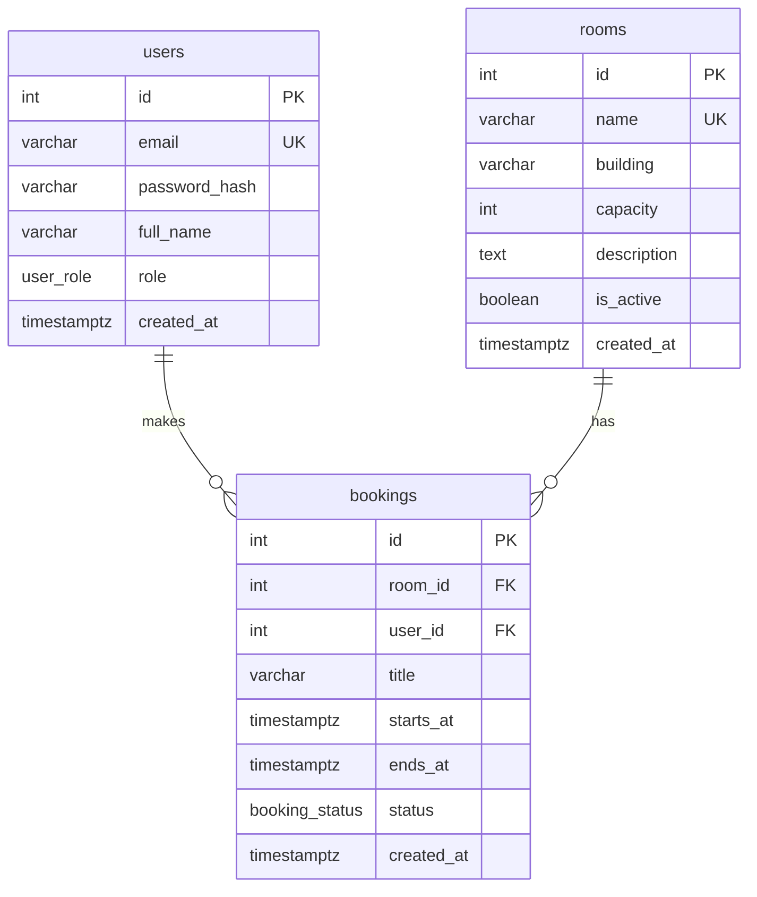

# Data model



## Tables

### users

| Column | Type | Notes |
|---|---|---|
| id | int | PK |
| email | varchar(255) | unique, used for login |
| password_hash | varchar(255) | bcrypt |
| full_name | varchar(255) | |
| role | enum `user_role` | `user` / `admin`, default `user` |
| created_at | timestamptz | default `now()` |

### rooms

| Column | Type | Notes |
|---|---|---|
| id | int | PK |
| name | varchar(100) | unique, e.g. `A-101` |
| building | varchar(100) | |
| capacity | int | `> 0` |
| description | text | nullable |
| is_active | boolean | default `true`, rooms are never hard deleted because bookings reference them |
| created_at | timestamptz | default `now()` |

### bookings

| Column | Type | Notes |
|---|---|---|
| id | int | PK |
| room_id | int | FK → `rooms.id` |
| user_id | int | FK → `users.id` |
| title | varchar(200) | e.g. `Project meeting` |
| starts_at | timestamptz | stored in UTC |
| ends_at | timestamptz | stored in UTC, `> starts_at` |
| status | enum `booking_status` | `active` / `cancelled`, default `active` |
| created_at | timestamptz | default `now()` |

## Constraints

- `CHECK (ends_at > starts_at)`
- No overlapping active bookings for the same room, enforced in the db (needs `btree_gist`):

```sql
EXCLUDE USING gist (
    room_id WITH =,
    tstzrange(starts_at, ends_at, '[)') WITH &&
) WHERE (status = 'active')
```

`[)` means a booking ending at 10:00 doesn't collide with one starting at 10:00. Cancelled bookings don't block the slot.
